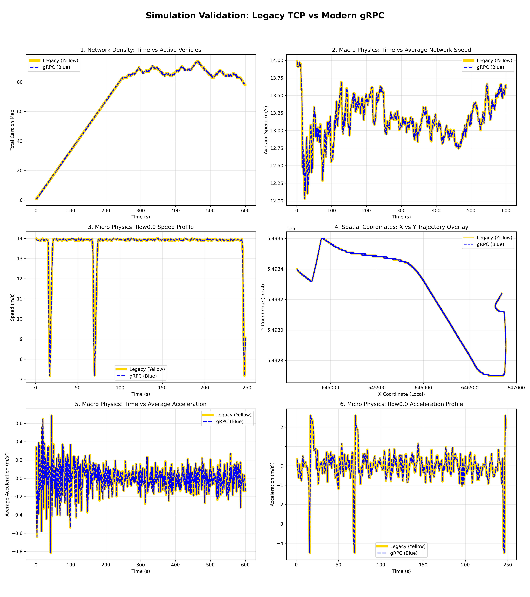
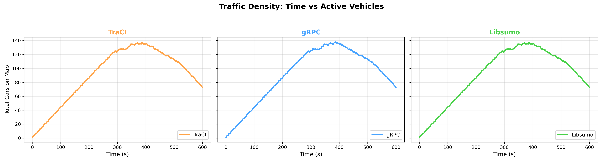
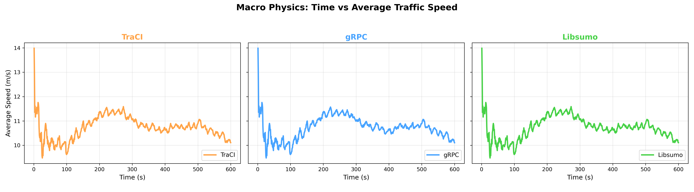
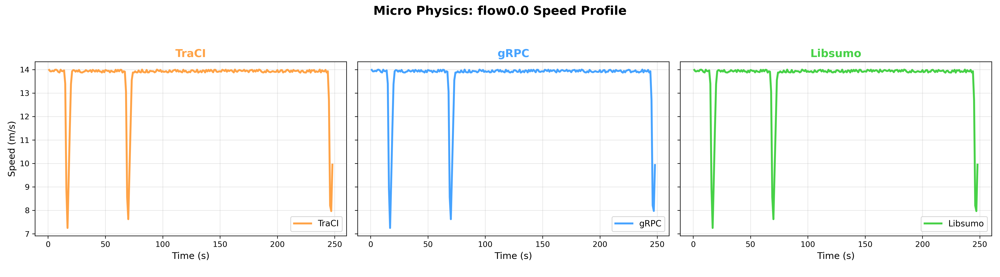
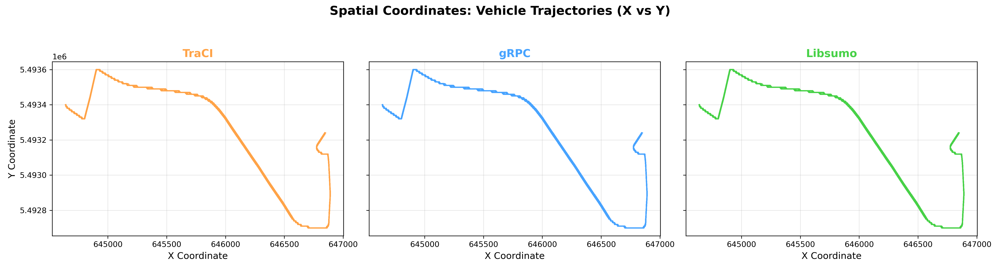
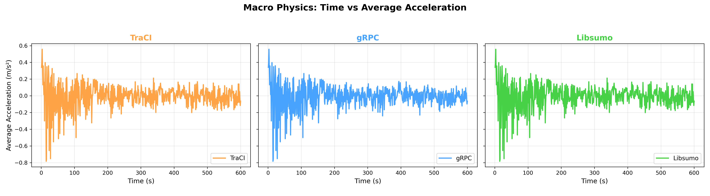
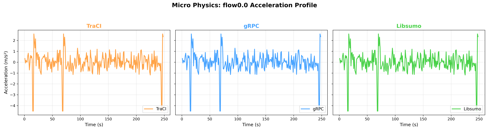

# Simulation Validation: Legacy TCP vs Modern gRPC

This repository contains the validation scripts and data for comparing the macroscopic and microscopic physics output of a Legacy TraCI TCP coupling versus a Modern gRPC coupling in an OMNeT++ and SUMO traffic simulation.

## Data Processing & Visualization Tools

The `plot_validation.py` script leverages the following Python data science libraries to process the simulation data and generate the validation dashboard:

* **Pandas**: Used for loading the heavy CSV datasets, standardizing columns, sorting data chronologically by simulation time and vehicle ID, and performing complex aggregations (like computing the network's average speed, average acceleration, or active vehicle counts per second).
* **Matplotlib**: Used as the visualization engine to take the processed data and render the 3x2 grid validation dashboard, including line plots, legends, and the spatial coordinate map overlay.
* **NumPy**: While not imported directly, NumPy runs under the hood of Pandas to provide the high-performance numerical calculations necessary to process the 54,000+ rows of simulation physics data almost instantaneously.

## How to Run the Script

1. Ensure we have the required libraries installed in our Python environment. we can verify this by running:
   ```bash
   python3 -c "import pandas; import matplotlib.pyplot as plt; print('Libraries are installed and ready')"
   ```

2. Open the terminal (or WSL) and navigate to the project directory: for example:
   ```bash
   cd "/mnt/f/4. Academic(MSc)/Thesis/PLOT"
   ```

3. Run the validation plotting script:
   ```bash
   python3 plot_validation.py
   ```

4. Upon completion, the script will automatically generate and save a high-resolution image named `thesis_validation_dashboard.png` in the same directory.

## Validation Dashboard Output



========================================================================================================================================================

# Simulation Validation: 3-Architecture Comparison (Legacy TraCI vs Modern gRPC vs Monolithic libsumo)

This section provides the validation scripts and comparison for evaluating all three co-simulation coupling architectures: **Legacy TraCI (TCP)**, **Modern gRPC**, and the in-process **Monolithic libsumo** coupling in OMNeT++ and SUMO.

## Data Processing & Visualization Layout

The `plot_3arch_comparison.py` script compares the 600-second simulation runs (`Legacy_physics_600.csv`, `grpc_physics_600.csv`, and `libsumo_physics_600.csv`). Rather than overlapping lines, it renders side-by-side subplots ($1 \times 3$ horizontal layout) with synchronized axes for clear comparative evaluation.

### Architecture Color Coding:
* **Legacy TraCI:** Brown (`saddlebrown`)
* **Modern gRPC:** Blue (`royalblue`)
* **Monolithic libsumo:** Green (`forestgreen`)

## How to Run the 3-Architecture Comparison Script

1. Navigate to the project directory:
   ```bash
   cd "/mnt/f/4. Academic(MSc)/Thesis/PLOT"
   ```

2. Run the 3-architecture comparison script:
   ```bash
   python3 plot_3arch_comparison.py
   ```

3. Upon completion, the script will automatically generate 6 high-resolution ($300\text{ DPI}$) comparison images:
   * `1_traffic_density_comparison.png` — Active vehicles over time (1x3 side-by-side)
   * `2_macro_speed_comparison.png` — Network-wide average fleet speed (1x3 side-by-side)
   * `3_micro_speed_comparison.png` — Single vehicle (`flow0.0`) speed profile (1x3 side-by-side)
   * `4_spatial_trajectories_comparison.png` — Spatial coordinate trajectories $X$ vs $Y$ (1x3 side-by-side)
   * `5_macro_acceleration_comparison.png` — Network-wide average acceleration (1x3 side-by-side)
   * `6_micro_acceleration_comparison.png` — Single vehicle (`flow0.0`) acceleration profile (1x3 side-by-side)

## 3-Architecture Validation Outputs

### 1. Traffic Density Comparison


### 2. Macro Average Traffic Speed Comparison


### 3. Micro Vehicle Speed Profile Comparison


### 4. Spatial Trajectories Comparison


### 5. Macro Average Acceleration Comparison


### 6. Micro Vehicle Acceleration Profile Comparison
